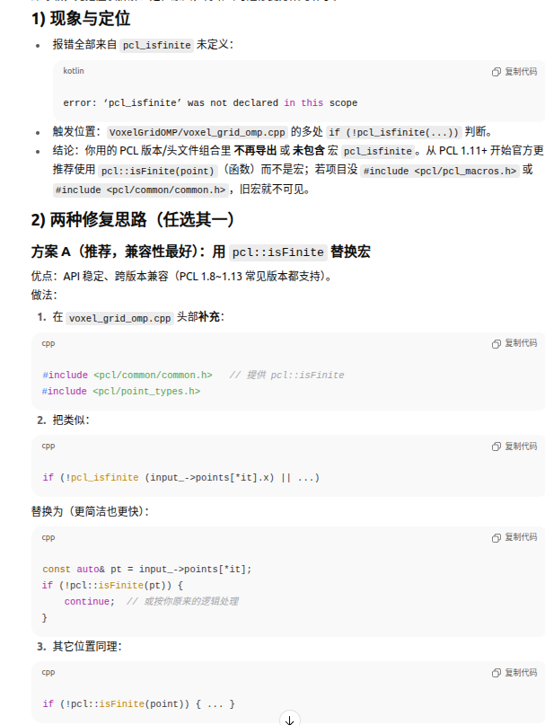
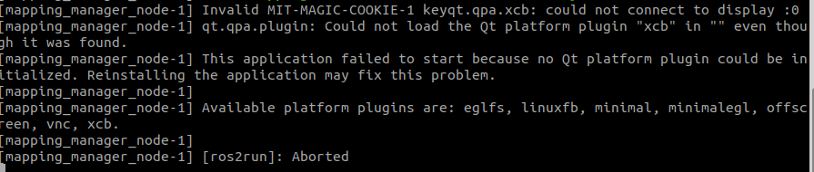

## create docker with rviz

```bash
#!/bin/bash

# ----------------------------
# 配置参数
# ----------------------------
CONTAINER_NAME=ros2_auto
IMAGE_NAME=osrf/ros:humble-desktop
WORKSPACE_DIR=$HOME/auto_ws    # 你的代码路径
DATA_DIR=$HOME/data            # 你的数据路径

# ----------------------------
# X11 配置（支持 RViz2/Gazebo 图形界面）
# ----------------------------
xhost +local:docker

# ----------------------------
# 如果容器已经存在，先删除
# ----------------------------
if [ "$(docker ps -aq -f name=^${CONTAINER_NAME}$)" ]; then
    echo ">>> Removing old container: $CONTAINER_NAME"
    docker rm -f $CONTAINER_NAME
fi

# ----------------------------
# 运行容器
# ----------------------------
docker run -it \
    --name $CONTAINER_NAME \
    --net=host \
    --env="DISPLAY=$DISPLAY" \
    --env="QT_X11_NO_MITSHM=1" \
    --volume="/tmp/.X11-unix:/tmp/.X11-unix:rw" \
    --volume="$WORKSPACE_DIR:/root/auto_ws" \
    --volume="$DATA_DIR:/autocity/data" \
    $IMAGE_NAME \
    bash -c "mkdir -p /autocity/data/test1 && \
             source /opt/ros/humble/setup.bash && \
             cd /root/auto_ws && exec bash"

```

宿主机工作目录：$HOME/auto_ws， 数据路径：$HOME/data

docker中的对应目录：~/auto_ws，数据文件：/autocity/data

数据文件是共享目录的，可以在宿主机上操作。


创建好进入这个docker

```bash
#查看镜像
docker ps -a  --size

# 启动这个已存在的容器（后台运行）
docker start ros2_auto

# 进入容器交互式终端
docker exec -it ros2_auto /bin/bash


#if we want to process this data folder which mounted in docker in my ubuntu
ls -ld   ~/data
sudo chown -R $USER:$USER ~/data
```


how to set if you do not see the rviz run,check the docker

```bash
#1.在宿主机（非容器）检查 X 是否可用
echo $DISPLAY        # 通常是 :0 或 :1
xhost                # 看当前访问控制

#2.在容器里确认 Qt 插件已装 & 环境变量
echo $DISPLAY        # 应该继承为 :0 或 unix/:0
echo $XAUTHORITY     # 通常应为 /root/.Xauthority 或 /home/xxx/.Xauthority
ls /usr/lib/*/qt*/plugins/platforms | grep xcb

#3.看到 “No protocol specified / could not connect to display :0” 基本就是 X11 授权问题，按下文修。

#**宿主机：**允许本地容器访问 X，并准备授权文件
# 1.允许本地用户访问 X 服务（仅本机）
xhost +local:

# 找到本机的 Xauthority（常见是 ~/.Xauthority）
echo $XAUTHORITY  # 若为空，通常就是 ~/.Xauthority

#2启动容器：（把必要的挂载和环境都带上）
docker run -it --rm \
  -e DISPLAY=$DISPLAY \
  -e QT_X11_NO_MITSHM=1 \
  -v /tmp/.X11-unix:/tmp/.X11-unix:rw \
  -v $XAUTHORITY:/root/.Xauthority:ro \
  --name ros2_rviz \
  <你的镜像> bash

```


```
# 基础镜像：Ubuntu 22.04 + ROS 2 Humble
FROM ros:humble

# 设置非交互模式，防止 tzdata 等阻塞安装
ENV DEBIAN_FRONTEND=noninteractive

# 更新源并安装依赖
RUN apt update && apt install -y \
    libgoogle-glog-dev \
    nlohmann-json3-dev \
    vim \
    && apt clean \
    && rm -rf /var/lib/apt/lists/*

# 设置默认 shell
SHELL ["/bin/bash", "-c"]

# 创建工作空间目录（可按需修改）
WORKDIR /root/ros2_ws

# 初始化 ros2 环境
RUN echo "source /opt/ros/humble/setup.bash" >> ~/.bashrc
```


```bash
apt update
apt install -y libgoogle-glog-dev
apt install -y nlohmann-json3-dev
```

```bash
# if you do not see output of the mapping process or the rviz no results
export ROS_LOCALHOST_ONLY=1

source install/setup.bash

cd ~/auto_ws
rm -rf build/ install/ log/

# 一次性编译所有依赖的消息包
colcon build --symlink-install --packages-select mapping_msgs msfl_msgs shm_msgs

# 再编译 mapping_manager
# colcon build --symlink-install --packages-select mapping_manager --cmake-args "-DGTSAM_USE_SYSTEM_EIGEN=ON"

colcon build --packages-select mapping_manager --cmake-args "-DGTSAM_USE_SYSTEM_EIGEN=ON" -DCMAKE_BUILD_TYPE=Release

#run map manager
./install/mapping_manager/start.sh

#before play rosbag, we should source the workspace

```


```
#befroe compile map manager, we should clone the front_end record and backend lib to this 'mapping_manager/libs'
# or y7ou will encounter some errors

#error: error: ‘pcl_isfinite’ was not declared in this scope
```




#### ros2 bag convert to ros1

```bash
# the direct command
sudo pip install ros2bag-convert

ros2bag-convert xx.db3

#  when you have some
pip show ros2bag-convert


# db3 to mcp, you should set the convert_mcap.yaml 

apt install ros-humble-rosbag2-storage-mcap

ros2 bag convert -i /autocity/data/test1/2/sensor_data/check/check_0.db3 -o /autocity/data/test1/2/sensor_data/check/convert_mcap.yaml 

output_bags:
  - uri: ./check_0_mcap
    storage_id: mcap


#ros2 bag convert -i /autocity/data/test1/1/sensor_data/check/check_0.db3 -o /autocity/data/test1/1/sensor_data/check/convert_mcap.yaml 

# then convert mcp to rosbag, install first
apt install python3-pip
pip3 install rosbags


# source the related msg
source ~/auto_ws/install/setup.bash

rosbags-convert --src check_0_mcap/ --dst /autocity/data/test1/2/sensor_data/check/output.bag --dst-typestore ros1_noetic

```

#### ros1 bag convert to ros2

```bash
# the direct command
rosbags-convert --src outdoor_Mainbuilding_100Hz_2020-12-24-16-46-29.bag --dst outdoor_Mainbuilding_100Hz_2020-12-24-16-46-29 
```


## ros bag 压缩 to db3

```
cat > /home/auto/data/kengzi_line17/convert_out.yaml <<'YAML'
output_bags:
  - uri: /home/auto/data/kengzi_line17/db3_out
    storage_id: sqlite3
    all: true
YAML


# zstd -d mcap_zstd_20251023_13_55bag_0.mcap.zstd -o mcap_zstd_20251023_13_55bag_0.mcap

# we can slao directly merge the db, it will decompress the zstd first, and merge to db
ros2 bag convert   -i /autocity/data/kengzi-pc105/mcap_zstd_bag_2025_11_05-13_41_29 mcap   -o /autocity/data/kengzi-pc105/mcap_zstd_bag_2025_11_05-13_41_29/convert_out.yaml


ros2 bag convert -i /home/auto/data/luohu_aokang_nec575_20251023_13_55bag/mcap_zstd_20251023_13_55bag_0.mcap mcap   -o /home/auto/data/luohu_aokang_nec575_20251023_13_55bag/convert_out.yaml
```


### Open3D Issue:

```
git clone https://github.com/isl-org/Open3D
# Only needed for Ubuntu
util/install_deps_ubuntu.sh

mkdir build
cd build
cmake ..

make install
```


```
# -- Fetching ISPC compiler   Request completely sent off
# closing connection #0
#         --- LOG END --- 

# this was caused by proxy, download it mannually
wget https://github.com/ispc/ispc/releases/download/v1.16.1/ispc-v1.16.1-linux.tar.gz
mv ispc-v1.16.1-linux.tar.gz /home/auto/software/Open3D/3rdparty_downloads/ispc/ispc-v1.16.1-linux.tar.gz
cmake ..

# sometimes we need to desable some libs to avoid some errors, e.g. uninstall 

```


## cloudcompare install issue:

```
# 若只需 PCD 支持，开启 QPCL 即可，关闭 qLASIO 和 qPDALIO 可大幅减少编译问题：
git pull
git submodule update --init --recursive

cmake .. -DPLUGIN_STANDARD_QPCL=ON -DPLUGIN_IO_QLAS=OFF -DPLUGIN_IO_QPDAL=OFF

rm -rf build/* 
mkdir build && cd build
```


### rviz issue





```
# 在宿主机执行
export DISPLAY=${DISPLAY:-:0}
XAUTH=/tmp/.docker.xauth
touch $XAUTH
xauth nlist "$DISPLAY" | sed -e 's/^..../ffff/' | xauth -f "$XAUTH" nmerge -

#允许本机的 root/本地用户访问 X（更安全的做法）
xhost +SI:localuser:root
```


### codex isseu

```bash
先清理环境变量，再只启用 HTTP 代理（如果你用的是 Clash/sing-box 的 7890 HTTP 端口）：
# 清理所有代理变量
unset http_proxy https_proxy all_proxy HTTP_PROXY HTTPS_PROXY ALL_PROXY no_proxy NO_PROXY

# 仅设置 HTTP/HTTPS 代理（示例：Clash 默认 7890）
export http_proxy="http://127.0.0.1:7890"
export https_proxy="http://127.0.0.1:7890"
export HTTP_PROXY="$http_proxy"
export HTTPS_PROXY="$https_proxy"
# 不要再设置 no_proxy（尤其不要包含 api.openai.com）

curl -I https://api.openai.com/v1/models   # 正常应返回 401（已联通）


```

若你的 SOCKS5 在 7891，改用：

```
unset http_proxy https_proxy HTTP_PROXY HTTPS_PROXY
export all_proxy="socks5://127.0.0.1:7891"
export ALL_PROXY="$all_proxy"
```

**切记不要** 同时混用 `http_proxy` 和 `all_proxy`。


**从同一个终端**启动 VSCode，这样 VSCode 与扩展会继承你刚才的代理变量：
